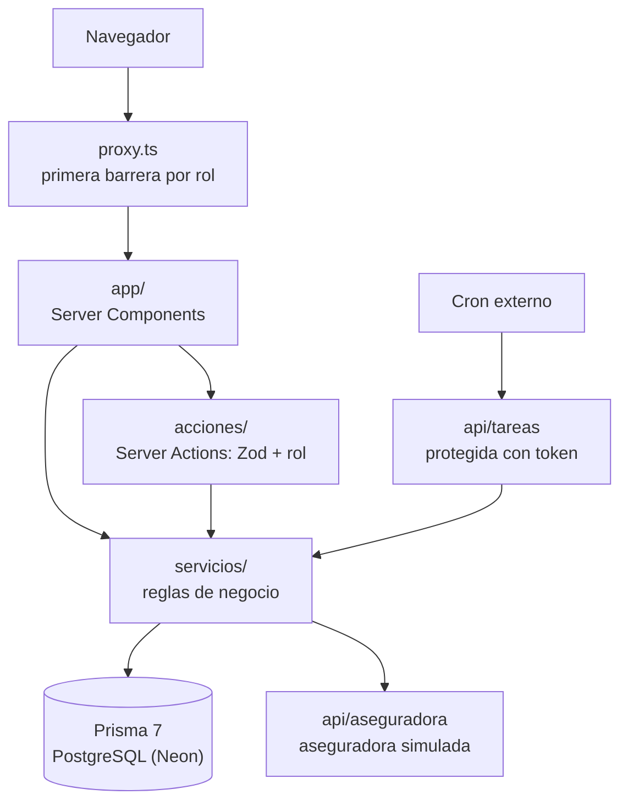

# Sistema de gestión de citas médicas — Hospital Central San Rafael


Prototipo funcional para agendar, confirmar, reprogramar y cancelar citas médicas, validar la cobertura con la aseguradora, enviar recordatorios, registrar la llegada y la atención de los pacientes y consultar reportes de gestión.

Proyecto académico de la asignatura **Diseño de Software** de la Fundación Universitaria del Área Andina. Implementa los **35 requisitos funcionales aprobados (RF-01 a RF-35)**.

## Contenido

1. [Alcance](#alcance)
2. [Funcionalidades](#funcionalidades)
3. [Arquitectura](#arquitectura)
4. [Tecnologías](#tecnologías)
5. [Puesta en marcha](#puesta-en-marcha)
6. [Configuración](#configuración)
7. [Datos de demostración](#datos-de-demostración)
8. [Guía de demostración](#guía-de-demostración)
9. [Tareas programadas](#tareas-programadas)
10. [Pruebas y calidad](#pruebas-y-calidad)
11. [Estructura del proyecto](#estructura-del-proyecto)
12. [Decisiones de diseño](#decisiones-de-diseño)
13. [Accesibilidad](#accesibilidad)
14. [Trazabilidad de requisitos](#trazabilidad-de-requisitos)

---

## Alcance

| Incluido | Fuera de alcance |
|---|---|
| Autenticación y control de acceso por rol | Historia clínica completa (solo hay un enlace simulado) |
| Registro de pacientes | Facturación y cartera |
| Médicos, especialidades, horarios y consultorios | Hospitalización, urgencias y quirófanos |
| Agendamiento, reprogramación y cancelación | Laboratorio, imágenes y farmacia |
| Validación de cobertura con la aseguradora (simulada) | Nómina |
| Notificaciones y recordatorios (bandeja de salida simulada) | Envío real de correos y SMS |
| Registro de llegada y atención | |
| Reportes de gestión con exportación a CSV y PDF | |

## Funcionalidades

| Módulo | Requisitos | Qué permite |
|---|---|---|
| 1. Autenticación y control de acceso | RF-01 a RF-04 | Inicio de sesión, siete roles con menú propio, bloqueo tras intentos fallidos y recuperación de contraseña con enlace de un solo uso. |
| 2. Registro de pacientes | RF-05 a RF-07 | Registro por portal o ventanilla, documento único y bitácora de cambios de contacto. |
| 3. Gestión de agenda | RF-08 a RF-11 | Especialidades, consultorios, médicos con varias especialidades, generación de espacios sin solapamiento y novedades que bloquean la agenda. |
| 4. Agendamiento | RF-12 a RF-20 | Búsqueda de espacios libres, reserva temporal, prevención de doble reserva, comprobante imprimible, reprogramación, cancelación y bitácora. |
| 5. Validación de cobertura | RF-21 a RF-23 | Consulta a la aseguradora, opción de atención particular y reintento en segundo plano. |
| 6. Notificaciones | RF-24 a RF-27 | Mensajes al confirmar, reprogramar o cancelar; recordatorio 48 horas antes con respuesta del paciente. |
| 7. Llegada y atención | RF-28 a RF-31 | Registro de llegada, agenda del día del médico, inicio y fin de la atención e inasistencias automáticas. |
| 8. Reportes de gestión | RF-32 a RF-35 | Ocupación, ausentismo y tiempos de espera, con gráficos y exportación a CSV y PDF. |

### Roles

| Rol | Pantalla de inicio | Responsabilidad principal |
|---|---|---|
| Administrador | Usuarios y roles | Cuentas, bandeja de salida y tareas programadas |
| Coordinador de agenda | Especialidades | Catálogos, médicos, disponibilidad y novedades |
| Director médico | Reportes | Indicadores de gestión |
| Recepcionista | Registro de llegada | Llegadas y agendamiento en ventanilla |
| Agente telefónico | Pacientes | Agendamiento telefónico |
| Médico | Agenda del día | Atención de pacientes |
| Paciente | Mis citas | Autogestión de sus citas y datos |

## Arquitectura

La aplicación es un monolito de Next.js (App Router) organizado en capas. Las páginas se renderizan en el servidor y las mutaciones pasan por Server Actions, que validan la entrada y el rol antes de delegar en los servicios de dominio.



| Capa | Ubicación | Responsabilidad |
|---|---|---|
| Protección de rutas | `src/proxy.ts` | Redirige según la sesión y el rol antes de renderizar. |
| Presentación | `src/app/`, `src/components/` | Pantallas públicas y del panel; componentes genéricos en `components/ui`. |
| Aplicación | `src/acciones/` | Server Actions: validan con Zod, verifican el rol y llaman a los servicios. |
| Dominio | `src/servicios/` | Reglas de negocio y acceso a datos, cubiertas con Vitest. |
| Soporte | `src/lib/` | Configuración, sesión, roles, fechas, etiquetas y esquemas de validación. |
| Persistencia | `prisma/` | Esquema, migraciones y semilla. |

## Tecnologías

| Uso | Herramienta |
|---|---|
| Aplicación | Next.js 16 (App Router, Server Components y Server Actions), React 19, TypeScript estricto |
| Estilos | Tailwind CSS 4, con componentes propios en `src/components/ui` |
| Datos | Prisma 7 con PostgreSQL alojado en Neon (`@prisma/adapter-pg`) |
| Validación | Zod 4, con mensajes en español |
| Autenticación | Contraseñas cifradas con `bcryptjs`, sesión en cookie `httpOnly` firmada con `jose`, protección por rol en `src/proxy.ts` |
| Fechas | `date-fns` y `@date-fns/tz` con la zona horaria `America/Bogota` |
| Reportes | Recharts para los gráficos y `pdf-lib` para exportar a PDF |
| Pruebas | Vitest (reglas de negocio), Playwright y axe-core (extremo a extremo y accesibilidad) |

## Puesta en marcha

### Requisitos previos

- Node.js 20.19 o superior (probado con Node.js 24)
- npm
- Una base de datos PostgreSQL (el proyecto usa Neon, conectado desde Vercel Marketplace)

### Instalación

```bash
npm install                 # instala dependencias y genera el cliente de Prisma
cp .env.example .env        # complete DATABASE_URL (o use `vercel env pull .env`)
npx prisma migrate deploy   # crea las tablas en la base PostgreSQL
npx prisma db seed          # carga los datos de prueba
npm run dev                 # http://localhost:3000
```

Para dejar la base como recién instalada: `npm run db:reset`.

### Scripts disponibles

| Comando | Descripción |
|---|---|
| `npm run dev` | Servidor de desarrollo en `http://localhost:3000`. |
| `npm run build` | Compilación de producción. |
| `npm start` | Sirve la compilación de producción. |
| `npm run lint` | Análisis estático con ESLint. |
| `npm run typecheck` | Verificación de tipos con TypeScript. |
| `npm test` | Pruebas unitarias con Vitest. |
| `npm run test:watch` | Vitest en modo observación. |
| `npm run test:e2e` | Pruebas extremo a extremo y de accesibilidad con Playwright. |
| `npm run db:reset` | Recrea la base de datos y vuelve a cargar la semilla. |
| `npm run vercel-build` | Lo ejecuta Vercel en cada despliegue: aplica las migraciones pendientes y compila. |

### Despliegue en Vercel

1. En el proyecto de Vercel, pestaña **Storage**, cree una base **Neon** y conéctela a los entornos Production y Preview. Esto define `DATABASE_URL` y `DATABASE_URL_UNPOOLED`.
2. En **Settings → Environment Variables** defina `SESSION_SECRET`, `TAREAS_TOKEN` y `APP_URL` (la dirección pública del despliegue).
3. Vuelva a desplegar. `vercel-build` crea las tablas con `prisma migrate deploy`.
4. Cargue los datos de demostración una sola vez desde su equipo: `vercel env pull .env` y luego `npx prisma db seed`.

## Configuración

### Variables de entorno

Se definen en `.env` (ver `.env.example`).

| Variable | Descripción | Valor por defecto |
|---|---|---|
| `DATABASE_URL` | Cadena de conexión de PostgreSQL (Neon, con pooler). **Obligatoria.** | Sin valor |
| `DATABASE_URL_UNPOOLED` | Conexión directa de Neon; la usan las migraciones y la semilla. La integración de Neon en Vercel la crea sola. | `DATABASE_URL` |
| `DATABASE_URL_PRUEBAS` | Base PostgreSQL exclusiva de las pruebas; se borra en cada ejecución. Debe ser distinta de `DATABASE_URL`. | Sin valor |
| `SESSION_SECRET` | Secreto para firmar la cookie de sesión (al menos 32 caracteres). **Obligatorio en producción.** | Valor de desarrollo (fuera de producción) |
| `TAREAS_TOKEN` | Token que exige la ruta `/api/tareas`. Si no se define, la ruta rechaza todas las llamadas (el botón de `/tareas` sigue funcionando). | Sin valor |
| `APP_URL` | Dirección pública de la aplicación; se usa en los enlaces de los mensajes simulados. | `http://localhost:3000` |

### Parámetros de negocio

Los supuestos pendientes de validar con el hospital están centralizados en `src/lib/configuracion.ts`; cualquier ajuste se hace solo en ese archivo.

| Parámetro | Valor inicial |
|---|---|
| Intentos fallidos antes de bloqueo | 3 |
| Duración del bloqueo de cuenta | 15 minutos |
| Vigencia del enlace de recuperación | 30 minutos |
| Reserva temporal de un espacio | 5 minutos |
| Anticipación mínima para cancelar | 24 horas |
| Envío del recordatorio | 48 horas antes |
| Tiempo máximo de espera a la aseguradora | 10 segundos |
| Marca de inasistencia | 20 minutos después de la hora |
| Semanas de espacios generados | 8 |

## Datos de demostración

### Credenciales de prueba

Todas las cuentas usan la contraseña **`Hospital2026`**.

| Rol | Correo |
|---|---|
| Administrador | `admin@hsr.test` |
| Coordinador de agenda | `coordinacion@hsr.test` |
| Director médico | `direccion@hsr.test` |
| Recepcionista | `recepcion@hsr.test` |
| Agente telefónico | `callcenter@hsr.test` |
| Médico (Dra. Laura Marcela Gómez Restrepo, medicina general) | `medico@hsr.test` |
| Paciente de demostración (sin citas futuras) | `paciente@hsr.test` |

Los otros 59 pacientes también tienen cuenta, con correos del tipo `carlos.rodriguez1@correo.test`; se pueden consultar en *Usuarios y roles* con la cuenta de administrador.

> **Cita de demostración para el registro de llegada.** La semilla deja al paciente con documento **`52037011`** con una cita confirmada hoy con la Dra. Laura Gómez, unos 30 minutos después de cargar los datos (el código se muestra al ejecutar `npx prisma db seed`). Sirve para probar la llegada en `/llegadas` y la atención en `/agenda-medico` a cualquier hora del día.

### Contenido de la semilla

`prisma/seed.ts` carga:

- 12 especialidades y 10 consultorios
- 24 médicos con disponibilidad semanal
- 3 aseguradoras
- 60 pacientes y un usuario por rol
- Espacios desde seis semanas atrás hasta ocho semanas adelante
- Unas 5.000 citas pasadas y futuras en todos los estados, para que los reportes tengan datos
- Una novedad de demostración para el jueves de la semana siguiente

### Aseguradora simulada

La ruta `/api/aseguradora/cobertura` responde según el **último dígito del documento** del paciente:

| Último dígito | Respuesta |
|---|---|
| `0` | Sin afiliación vigente: se ofrece agendar como particular (RF-22). |
| `8` | Plan básico: solo cubre medicina general y pediatría; en otras especialidades, sin cobertura (RF-22). |
| `9` | La consulta tarda más de 10 segundos: la cita queda pendiente de validación y el reintento en segundo plano sí obtiene respuesta (RF-23). |
| Otro | Afiliación vigente con cobertura. |

## Guía de demostración

Recorrido sugerido que atraviesa los ocho módulos:

1. **Paciente:** regístrese en `/registro`, agende en *Nueva cita* (especialidad, médico y fecha, horario, cobertura y confirmación) e imprima el comprobante.
2. **Administrador:** en *Tareas programadas* pulse «Ejecutar tareas programadas» y revise el recordatorio en *Bandeja de salida*; el enlace del mensaje permite confirmar o cancelar la cita sin iniciar sesión.
3. **Recepcionista:** registre la llegada del documento `52037011` en *Registro de llegada*.
4. **Médico:** en *Agenda del día* inicie y finalice la atención de ese paciente.
5. **Coordinador:** registre una novedad y revise las citas afectadas.
6. **Director médico:** filtre los reportes y descárguelos en CSV o PDF.

## Tareas programadas

Los procesos periódicos son:

- Liberación de reservas temporales vencidas (RF-14)
- Reintentos de validación de cobertura (RF-23)
- Envío de recordatorios (RF-25)
- Marca de inasistencia (RF-31)

Se ejecutan con el botón «Ejecutar tareas programadas» en `/tareas` (administrador) o llamando a la ruta protegida con el token `TAREAS_TOKEN`. En producción, un programador externo (cron) la invocaría cada pocos minutos:

```bash
curl -X POST http://localhost:3000/api/tareas -H "Authorization: Bearer <TAREAS_TOKEN>"
```

## Pruebas y calidad

```bash
npm run lint
npm run typecheck
npm test            # Vitest, con la base de DATABASE_URL_PRUEBAS (se recrea)
npm run test:e2e    # Playwright; recrea la base de pruebas, compila y levanta el servidor en el puerto 3200
```

La primera vez que se ejecuten las pruebas de Playwright hay que instalar el navegador: `npx playwright install chromium`.

| Conjunto | Cobertura |
|---|---|
| Vitest (`tests/unit/`) | Reglas de negocio de los 35 requisitos, incluidas las exigidas: RF-06, RF-13 (dos reservas simultáneas terminan con una sola cita), RF-14, RF-17, RF-18, RF-31 y la generación de espacios sin solapamiento de RF-10. |
| Playwright (`tests/e2e/`) | Flujo completo del paciente (registro, agendamiento con cobertura y confirmación por recordatorio), intento de doble reserva desde dos sesiones, registro de llegada seguido de atención, administración de agenda, autenticación y reportes. |
| Accesibilidad (`tests/e2e/accesibilidad.spec.ts`) | Revisa con axe-core las pantallas de todos los roles contra WCAG 2.1 A y AA a 360 px de ancho, y comprueba que no haya desplazamiento horizontal, que el idioma sea `es` y la codificación UTF-8. |

## Estructura del proyecto

```text
prisma/
  schema.prisma              Modelo de datos (índices únicos de RF-06 y RF-13)
  migrations/                Migraciones de PostgreSQL
  seed.ts                    Datos de prueba
src/
  proxy.ts                   Protección de rutas por rol (antes middleware.ts)
  acciones/                  Server Actions: validan con Zod, verifican el rol y llaman a los servicios
  servicios/                 Reglas de negocio y acceso a datos (probadas con Vitest)
  lib/                       Configuración, sesión, roles, fechas, etiquetas y esquemas de Zod
  components/                Componentes de interfaz; los genéricos están en ui/
  app/
    (publico)/               Inicio, inicio de sesión, registro, recuperación y respuesta al recordatorio
    (panel)/                 Pantallas con sesión, una carpeta por opción de menú
    api/aseguradora/         Aseguradora simulada
    api/tareas/              Tareas programadas protegidas con token
tests/
  unit/                      Pruebas de Vitest (base DATABASE_URL_PRUEBAS)
  e2e/                       Pruebas de Playwright (base DATABASE_URL_PRUEBAS)
```

## Decisiones de diseño

### Integridad de la agenda

- **Doble reserva (RF-13), en dos capas.** En la base de datos, `Espacio` tiene índices únicos sobre `(medicoId, inicio)` y `(consultorioId, inicio)`, y `Cita.espacioActivoId` es único: dos citas vigentes no pueden ocupar el mismo espacio. En la lógica, la Server Action verifica la reserva temporal y el estado del espacio dentro de una transacción. Una prueba lanza dos reservas simultáneas y comprueba que solo queda una cita.
- **Reprogramar (RF-16)** conserva el código de la cita, libera el espacio anterior y ocupa el nuevo en la misma transacción. Si la cita estaba confirmada, vuelve a «agendada» para recibir un nuevo recordatorio.
- **Cancelar (RF-17).** El paciente puede cancelar o reprogramar hasta 24 horas antes; recepción, el agente telefónico y el coordinador pueden hacerlo hasta la hora de la cita.
- **Novedades (RF-11 y RF-27).** Registrar una novedad bloquea los espacios y lista las citas afectadas; el coordinador decide cuándo cancelarlas y avisar a los pacientes.

### Atención

- **Atención (RF-30).** Una cita «en sala» con inicio de atención registrado se muestra como «en atención»; al finalizar queda «atendida».
- **Inasistencia (RF-31).** La cita conserva el espacio ocupado, porque la capacidad se ofreció y no se aprovechó; así lo cuenta el reporte de ocupación.

### Reportes

- **Indicadores (RF-32 a RF-34).** Se toman las citas y los espacios según la fecha de la cita. La ocupación divide los espacios con cita (también atendidas e inasistencias) entre los espacios ofertados, sin contar los bloqueados por novedades. Un médico con dos especialidades ofrece sus espacios a ambas. Los días de espera excluyen las citas canceladas; los minutos de espera usan las citas con llegada e inicio de atención registrados.
- **Exportación (RF-35).** El CSV usa punto y coma y marca BOM para que Excel en español muestre bien las tildes; el PDF se genera en el servidor, incluye los filtros aplicados y repite el encabezado de las tablas en cada página.

### Plataforma

- **`src/proxy.ts`.** En Next.js 16 el archivo `middleware.ts` cambió de nombre a `proxy.ts` y cumple la misma función. Es una primera barrera: cada página y cada Server Action vuelve a verificar la sesión y el rol contra la base de datos.
- **Correos y SMS** no se envían: quedan en la bandeja de salida (`/bandeja-salida`, cuenta de administrador).
- **Fechas.** Se guardan en UTC y se muestran en hora de Bogotá con formato dd/mm/aaaa y 24 h.

## Accesibilidad

- Paleta azul petróleo y blanco con acento naranja oscuro para las acciones principales; todas las combinaciones de texto cumplen el contraste AA.
- Tipografía sans serif con tamaño base de 16 px; controles de al menos 44 px de alto.
- Los estados de las citas se muestran con color y texto; las alertas, con símbolo y título.
- Enlace «Saltar al contenido principal», foco visible en todos los controles, etiquetas visibles en los formularios y mensajes de error asociados a cada campo.
- Diseño adaptable desde 360 px; las tablas se desplazan dentro de su recuadro.
- Los gráficos de los reportes tienen descripción y una tabla con las mismas cifras.
- Estados vacíos, de carga y de error en las pantallas públicas y en las del panel.

## Trazabilidad de requisitos

Cada Server Action o servicio que implementa un requisito lleva un comentario con su identificador (por ejemplo, `// RF-13: …`), de modo que `grep -rn "RF-13" src` lista todos los puntos donde se cumple. Las rutas de archivo son relativas a `src/`; las pruebas `*.test.ts` están en `tests/unit/` y las `*.spec.ts` en `tests/e2e/`.

<details>
<summary><strong>Módulo 1. Autenticación y control de acceso</strong> (RF-01 a RF-04)</summary>

| RF | Requisito | Lógica | Pantalla o ruta | Pruebas |
|---|---|---|---|---|
| RF-01 | Inicio de sesión con cuentas activas | `servicios/autenticacion.ts`, `acciones/autenticacion.ts`, `lib/sesion.ts`, `lib/token-sesion.ts` | `app/(publico)/iniciar-sesion/`, `proxy.ts` | `autenticacion.test.ts`, `sesion-y-roles.test.ts`, `autenticacion.spec.ts` |
| RF-02 | Siete roles con menú propio | `servicios/usuarios.ts`, `acciones/usuarios.ts`, `lib/roles.ts` | `app/(panel)/usuarios/`, `app/(panel)/layout.tsx` | `sesion-y-roles.test.ts`, `autenticacion.spec.ts` |
| RF-03 | Bloqueo tras tres intentos y aviso | `servicios/autenticacion.ts` | `app/(publico)/iniciar-sesion/` | `autenticacion.test.ts`, `autenticacion.spec.ts` |
| RF-04 | Enlace de recuperación de un solo uso | `servicios/autenticacion.ts`, `acciones/autenticacion.ts` | `app/(publico)/recuperar-contrasena/`, `app/(publico)/restablecer-contrasena/[token]/` | `autenticacion.test.ts`, `autenticacion.spec.ts` |

</details>

<details>
<summary><strong>Módulo 2. Registro de pacientes</strong> (RF-05 a RF-07)</summary>

| RF | Requisito | Lógica | Pantalla o ruta | Pruebas |
|---|---|---|---|---|
| RF-05 | Datos del registro por portal o ventanilla | `servicios/pacientes.ts`, `acciones/pacientes.ts`, `lib/validaciones/pacientes.ts` | `app/(publico)/registro/`, `app/(panel)/pacientes/nuevo/` | `pacientes.test.ts`, `pacientes-y-agenda.spec.ts` |
| RF-06 | Documento único | `servicios/pacientes.ts`, índice único en `prisma/schema.prisma` | `app/(publico)/registro/`, `app/(panel)/pacientes/nuevo/` | `pacientes.test.ts`, `pacientes-y-agenda.spec.ts` |
| RF-07 | Cambio de contacto con usuario, fecha y hora | `servicios/pacientes.ts`, `servicios/bitacora.ts` | `app/(panel)/mis-datos/`, `app/(panel)/pacientes/[id]/`, `app/(panel)/bitacora/` | `pacientes.test.ts`, `pacientes-y-agenda.spec.ts` |

</details>

<details>
<summary><strong>Módulo 3. Médicos, especialidades, horarios y consultorios</strong> (RF-08 a RF-11)</summary>

| RF | Requisito | Lógica | Pantalla o ruta | Pruebas |
|---|---|---|---|---|
| RF-08 | Especialidades y consultorios | `servicios/catalogos.ts`, `acciones/coordinacion.ts` | `app/(panel)/coordinacion/especialidades/`, `app/(panel)/coordinacion/consultorios/` | `agenda.test.ts`, `pacientes-y-agenda.spec.ts` |
| RF-09 | Médicos con una o más especialidades | `servicios/medicos.ts`, `acciones/coordinacion.ts` | `app/(panel)/coordinacion/medicos/` | `agenda.test.ts`, `pacientes-y-agenda.spec.ts` |
| RF-10 | Generación de espacios sin solapamiento | `servicios/generador-espacios.ts`, `servicios/disponibilidad.ts` | `app/(panel)/coordinacion/disponibilidad/` | `generador-espacios.test.ts`, `agenda.test.ts` |
| RF-11 | Novedades que bloquean espacios | `servicios/novedades.ts` | `app/(panel)/coordinacion/novedades/` | `agenda.test.ts`, `pacientes-y-agenda.spec.ts` |

</details>

<details>
<summary><strong>Módulo 4. Agendamiento, reprogramación y cancelación</strong> (RF-12 a RF-20)</summary>

| RF | Requisito | Lógica | Pantalla o ruta | Pruebas |
|---|---|---|---|---|
| RF-12 | Espacios libres filtrados | `servicios/agendamiento.ts` | `components/citas/asistente-horarios.tsx`, `app/(panel)/mis-citas/nueva/`, `app/(panel)/agendar/` | `agendamiento.test.ts`, `agendamiento.spec.ts` |
| RF-13 | Sin doble reserva | `servicios/agendamiento.ts`, índices únicos en `prisma/schema.prisma` | Asistente de agendamiento | `agendamiento.test.ts` (reservas simultáneas), `agendamiento.spec.ts` (dos sesiones) |
| RF-14 | Reserva temporal de cinco minutos | `servicios/agendamiento.ts`, `servicios/tareas.ts` | `components/citas/cuenta-regresiva.tsx` | `agendamiento.test.ts`, `agendamiento.spec.ts` |
| RF-15 | Código único y comprobante imprimible | `servicios/agendamiento.ts`, `lib/codigos.ts` | `components/citas/comprobante-cita.tsx` | `agendamiento.test.ts`, `agendamiento.spec.ts` |
| RF-16 | Reprogramación en una transacción | `servicios/agendamiento.ts`, `acciones/citas.ts` | `app/(panel)/mis-citas/[id]/reprogramar/`, `app/(panel)/citas/[id]/reprogramar/` | `agendamiento.test.ts`, `agendamiento.spec.ts` |
| RF-17 | Cancelación con 24 horas de anticipación | `servicios/agendamiento.ts`, `acciones/citas.ts` | `components/citas/pagina-detalle-cita.tsx` | `agendamiento.test.ts`, `agendamiento.spec.ts` |
| RF-18 | Una cita activa por especialidad | `servicios/agendamiento.ts` | Asistente de agendamiento | `agendamiento.test.ts` |
| RF-19 | Canal de origen y usuario creador | `servicios/agendamiento.ts`, `acciones/citas.ts` | `app/(panel)/agendar/` (ventanilla o teléfono según el rol) | `agendamiento.test.ts` |
| RF-20 | Bitácora de creación, reprogramación y cancelación | `servicios/bitacora.ts`, `servicios/agendamiento.ts` | `app/(panel)/bitacora/` | `agendamiento.test.ts` |

</details>

<details>
<summary><strong>Módulo 5. Validación de cobertura</strong> (RF-21 a RF-23)</summary>

| RF | Requisito | Lógica | Pantalla o ruta | Pruebas |
|---|---|---|---|---|
| RF-21 | Consulta de vigencia y cobertura | `servicios/cobertura.ts`, `servicios/aseguradora-simulada.ts` | `app/api/aseguradora/cobertura/route.ts`, `components/citas/confirmacion-cita.tsx` | `agendamiento.test.ts`, `agendamiento.spec.ts` |
| RF-22 | Opción de agendar como particular | `servicios/cobertura.ts`, `servicios/agendamiento.ts` | `components/citas/confirmacion-cita.tsx` | `agendamiento.test.ts`, `agendamiento.spec.ts` |
| RF-23 | Pendiente de validación y reintento | `servicios/cobertura.ts`, `servicios/tareas.ts` | `components/citas/confirmacion-cita.tsx`, `app/api/tareas/route.ts` | `agendamiento.test.ts`, `agendamiento.spec.ts` |

</details>

<details>
<summary><strong>Módulo 6. Notificaciones y recordatorios</strong> (RF-24 a RF-27)</summary>

| RF | Requisito | Lógica | Pantalla o ruta | Pruebas |
|---|---|---|---|---|
| RF-24 | Correo y SMS al confirmar, reprogramar o cancelar | `servicios/mensajes-cita.ts`, `servicios/notificaciones.ts` | `app/(panel)/bandeja-salida/` | `notificaciones.test.ts` |
| RF-25 | Recordatorio 48 horas antes | `servicios/recordatorios.ts`, `servicios/tareas.ts` | `app/(panel)/tareas/`, `app/api/tareas/route.ts` | `notificaciones.test.ts`, `notificaciones.spec.ts` |
| RF-26 | Respuesta del paciente al recordatorio | `servicios/recordatorios.ts`, `acciones/recordatorios.ts` | `app/(publico)/responder-cita/[token]/` | `notificaciones.test.ts`, `notificaciones.spec.ts` |
| RF-27 | Aviso por cancelación por novedad | `servicios/novedades.ts`, `servicios/mensajes-cita.ts` | `app/(panel)/coordinacion/novedades/[id]/` | `notificaciones.test.ts` |

</details>

<details>
<summary><strong>Módulo 7. Registro de llegada y atención</strong> (RF-28 a RF-31)</summary>

| RF | Requisito | Lógica | Pantalla o ruta | Pruebas |
|---|---|---|---|---|
| RF-28 | Llegada por documento o código | `servicios/atencion.ts`, `acciones/atencion.ts` | `app/(panel)/llegadas/` | `atencion.test.ts`, `atencion.spec.ts` |
| RF-29 | Lista del día del médico, actualizada sola | `servicios/atencion.ts` | `app/(panel)/agenda-medico/`, `components/atencion/actualizacion-automatica.tsx` | `atencion.test.ts`, `atencion.spec.ts` |
| RF-30 | Inicio y fin de la atención, enlace a historia clínica | `servicios/atencion.ts`, `acciones/atencion.ts` | `app/(panel)/agenda-medico/[id]/`, `app/(panel)/historia-clinica/[pacienteId]/` | `atencion.test.ts`, `atencion.spec.ts` |
| RF-31 | Inasistencia 20 minutos después | `servicios/atencion.ts`, `servicios/tareas.ts` | `app/api/tareas/route.ts` | `atencion.test.ts` |

</details>

<details>
<summary><strong>Módulo 8. Reportes de gestión</strong> (RF-32 a RF-35)</summary>

| RF | Requisito | Lógica | Pantalla o ruta | Pruebas |
|---|---|---|---|---|
| RF-32 | Ocupación por especialidad, médico y consultorio | `servicios/reportes.ts` (`reporteOcupacion`) | `app/(panel)/reportes/`, `components/reportes/` | `reportes.test.ts`, `reportes.spec.ts` |
| RF-33 | Inasistencias y cancelaciones por especialidad y canal | `servicios/reportes.ts` (`reporteAusentismo`) | `app/(panel)/reportes/` | `reportes.test.ts`, `reportes.spec.ts` |
| RF-34 | Días entre solicitud y cita, minutos entre llegada y atención | `servicios/reportes.ts` (`reporteTiempos`) | `app/(panel)/reportes/` | `reportes.test.ts` |
| RF-35 | Exportación a CSV y PDF con los filtros aplicados | `servicios/documentos-reporte.ts`, `servicios/exportacion-reportes.ts` | `app/(panel)/reportes/exportar/route.ts` | `reportes.test.ts`, `reportes.spec.ts` |

</details>

---

Proyecto académico — Diseño de Software, Fundación Universitaria del Área Andina.
